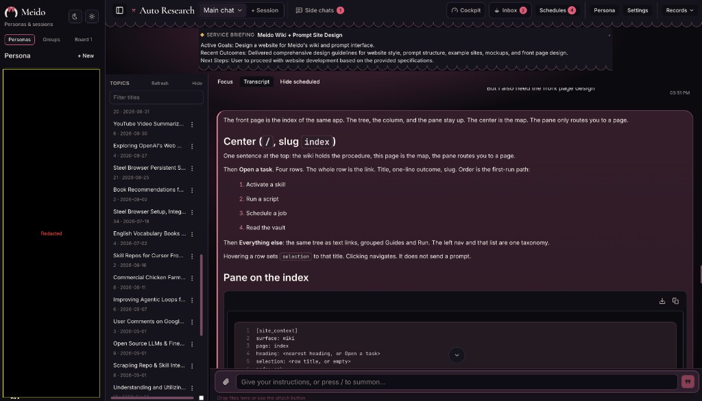

<p align="center">
  
</p>

<h1 align="center">Meido</h1>

<p align="center"><strong>对话不必从头再来。</strong></p>

<p align="center">
  <a href="README.md">English</a> ·
  <a href="README.zh-CN.md">简体中文</a> ·
  <a href="README.ja.md">日本語</a>
</p>

一场对话，靠多维上下文维持：三层记忆、MemPalace 召回、Service briefing，以及 Obsidian 知识库。
一个 Rust 运行时把这场对话带到网页和各个聊天渠道，并接上定时任务、SOP 约束和可追溯的历史。

[让对话继续 →](#快速开始)

<p align="center">
  
</p>

<p align="center"><em>一张操作台，一份记录。话题给这段记录里的各段起标题。Service briefing 位于线程上方。Focus 和 Transcript 是同一场对话的两种视图。</em></p>

## 不必再开一个新对话

云端聊天机器人是一叠已经结束的会话。窗口满了，线程就断了，下一条消息从零开始。
进行中的工作留在上一个窗口里，你只能在新对话里把它重新讲一遍。

Meido 没有会话边界。每一轮都会整理上下文，所以同一场对话可以继续。不必为了接着聊而新开一条线程。

## 对话如何一直进行

**同一条线程。** 网页、Telegram、Discord、WhatsApp、企业微信和定时任务进入同一场对话。
没有“新会话”需要恢复，每个渠道也不会各自长出一套智能体。

**分层的上下文。** 长期事实、进行中的工作、近期焦点分开存放。很长的对话不会塌缩成最后几句话，
一阵近期细节也不会盖掉这项工作仍然依赖的内容。

**按需召回。** MemPalace 和 Obsidian 知识库只带回这一轮需要的内容。资料库不会整段贴进提示词，
也不会被关进一个已经结束的会话。

**焦点跟着工作移动。** Service briefing 和话题列表说明这场对话现在在做什么。更早的回合仍留在历史里。

## 新对话，还是同一场对话

**一轮从哪里开始**

- 常见的云端聊天机器人会开启一个会话。你下次回来，就要再开一个。
- Meido 接着你已经在进行的那场对话。

**窗口满了以后**

- 常见的云端聊天机器人结束这条线程。下一条提示没有过去。
- Meido 按预算裁剪历史，并保留其余上下文：三层记忆、召回、Service briefing 和知识库。

**上下文放在哪里**

- 常见的云端聊天机器人把上下文留在那个会话里，放在别人的服务上。
- Meido 把它留在你的机器上：Persona 记忆、MemPalace，以及你能直接阅读的 Markdown 知识库。

**你可以在哪里说话**

- 常见的云端聊天机器人只有一个窗口。
- Meido 是同一场对话，出现在网页、Telegram、Discord、WhatsApp 和企业微信。

**窗口之外的工作**

- 常见的云端聊天机器人要等你再次打开它。
- 定时任务和后台工作回到同一场对话，使用同一个 Persona 和同一套工具。

**事后能核对什么**

- 常见的云端聊天机器人留下的是一个已关闭会话的记录。
- Meido 留下智能体历史、只追加的记忆事件，以及绑定到该次运行的产物。
  工具在服务端授权，密钥保持遮盖，知识库 SOP 留在上下文里。

## 让对话继续

安装程序，启动 Meido，在网页界面完成设置。[快速开始](#快速开始)。

## Meido 如何思考

一轮对话是组装出来的，不是整包倒进去的。身份、原则、分层记忆、你启用的技能、
知识库操作规程和当前任务会组成这一轮的上下文。较早的历史按预算裁剪。图片有上限。
记录始终是同一场对话。

所有入口走同一条路径。网页界面、Telegram、Discord、WhatsApp、企业微信和调度器各自解析出一个聊天，
再交给同一个运行时。渠道不会自己再长出一个智能体。

引擎可以选择，上下文不能拆开。每个 Persona 可以运行内置工具循环 Classic、Cursor 或 Gemini ADK。
记忆、权限、Hook 和投递始终包在这个选择外面。

聊天模型不是后台模型。系统 LLM 负责话题标题和 Service briefing 这类安静的工作。这一对没有配好时，该任务会跳过。
它不会悄悄借用 Persona 的聊天模型。

工作有规程。知识库 SOP 是上下文的一部分。工具在服务端授权。密钥保持遮盖。路径按 Persona 限定。
一轮结束后，历史和产物都还可以检查。

## 你实际用到的部分

### 操作台

网页操作台是你运行 Meido 的地方。工作区、知识库、模型、系统 LLM、MemPalace 和托管浏览器尚未就绪时，
设置向导会打开。其余内容在设置和 Persona 页面修改。工作目录里的 `.env` 是启动配置。
工作区、绑定地址和知识库路径的改动需要重启。API 密钥和运行时开关在保存后生效。
在 macOS 和 Linux 上，可选的登录服务会在登录时启动 Meido。

### Persona

一个 Persona 有名称、引擎、模型、自己的记忆、Service briefing、Hook、技能和外部路径。
多个 Persona 可以共享同一个聊天。每个 Persona 用自己的上下文回答。

### 持续的对话

操作台就是这场对话。侧栏里是 Persona、群组和看板。打开的 Persona 保持一份记录。
旁边的话题列表给同一份记录里的各段起标题，筛选标题也不会新开一个会话。
线程上方的 Service briefing 写明这场聊天现在在做什么。Focus 和 Transcript 是它的两种视图。
Hide scheduled 把定时运行先收起来，并不删除它们。Side chats 仍附在这条线程上。
书签跳回其中的某条消息。

### 让对话继续的上下文

三层分别保存长期事实、进行中的工作和近期焦点。MemPalace 召回相关内容。
Service briefing 在线程上方写出当前焦点。Obsidian 知识库是你可以阅读、搜索和索引的 Markdown。
Persona 记忆的逐字段说明见[英文 README 的记忆规范](README.md#memory-file-spec)。

### 协作

输入 `@Name` 邀请另一个 Persona。访客按你标注的顺序、以自己的身份在宿主记录上回答。
群组是另一场对话，有自己的记录。看板有四个阶段：TODO、PLAN、BUILD、VERIFY。
每张卡片都有 Deploy 和 Complete。栏位上方的 Today 是卡片、运行和即将开始的工作的实时概览。

### 继续进行的工作

定时任务和后台任务使用与实时回合相同的 Persona 和工具。较长的 shell 命令可以在后台运行。
完成的运行可以重新附回对话。一次运行发布的文件会成为绑定到该次运行的产物，而不是丢在回复里的路径。

### 引擎与模型

Classic 是内置工具循环。Cursor 和 Gemini ADK 是另外两种引擎，按 Persona 选择。
可以连接 Anthropic、OpenAI、Gemini 或其他已配置的提供方，也可以把 Persona 指向本地服务
（`ollama`、`llama` 或 `llamacpp`）。不需要云端模型的工作，可以留在本地路由上。

### 由你安装的部分

技能和 MCP 服务由你安装在这台机器上。Meido 只启用该 Persona 被允许使用的技能，
并连接你配置的 MCP 服务。没有一份必须接受的固定目录。

### Hook

检查围绕一轮进行：开始之前、工具使用前后、回复投递之前，以及投递之后。
内置检查会同步焦点、应用调度策略、限制技能、拦住卡住的工具循环、处理不适合直接丢进聊天的过密回复，
并清除密钥。你也可以添加自己的检查。

### 它能接触的机器

Meido 在你的工作区里工作：文件、shell，以及感知代码仓库的编辑。需要打开网页而不只是调用 API 时，
可以从设置向导安装托管浏览器 Steel。新工作区会从 [`defaults/AGENTS.md`](defaults/AGENTS.md)
得到操作原则。已有的原则文件保持原样。

### 渠道

网页界面本身就够用。Telegram、Discord、WhatsApp 和企业微信是到达同一场对话的可选方式。

### 安全与追溯

工具使用在服务端授权。每个 Persona 有自己的路径范围。密钥保持遮盖，输出会脱敏。
知识库 SOP 留在上下文中。记忆变更追加到事件日志。智能体历史记录这一轮实际是怎么跑的。

## 快速开始

### 1. 安装

Linux / macOS：

```bash
curl -fsSL https://raw.githubusercontent.com/kenpyfin/meido/main/install.sh | bash
```

Windows 请使用 [`install.ps1`](install.ps1)。从源码构建：

```bash
cargo build --release
cd web && npm ci && npm run build
```

### 2. 初始化配置

Meido 从当前目录的 `.env` 读取配置；也可以通过 `MEIDO_CONFIG` 指定路径。

```bash
cp .env.example .env
```

只需先设置工作区和 Web 启动参数。LLM、知识库、MemPalace、Steel Browser、渠道和
Persona 可在 Web 设置向导中完成配置。请勿提交 `.env`。

### 3. 启动

```bash
meido start
```

打开 **http://127.0.0.1:10961**。`meido start` 会在后台运行；使用 `meido stop`
停止，或添加 `--foreground` 保持前台运行。

Web UI 本身即可独立使用，Telegram、Discord、WhatsApp 和企业微信均为可选渠道。
至少配置一个云端模型 API 密钥，或选择无需密钥的本地模型服务。

### 4. 可选的登录自启动服务

macOS 和 Linux 可安装用户级服务：

```bash
meido gateway install
meido gateway status
meido gateway logs
```

## 记忆模型

每个聊天和 Persona 的规范记忆保存在：

- `groups/{chat_id}/{persona_id}/memory_state.json` — 当前三层记忆状态
- `groups/{chat_id}/{persona_id}/memory_events.jsonl` — 仅追加的审计与恢复事件

`memory_state.json` 包含身份、长期记忆、活跃项目、近期关注、工作模式记忆以及
MemPalace 引用。写入前会进行规范化与验证，并使用临时文件、原子重命名和备份保护数据。

完整配置项请参阅 [`.env.example`](.env.example)，更详细的字段定义和运维说明请查看
[英文 README](README.md)。

## 许可证

混合许可证，详见 [LICENSE](LICENSE)。

- **kenpyfin 在 2026 年的修改与新增文件：** 专有、源码可见；允许个人非商业使用，
  不允许复制、再分发或重新授权这些修改。
- **源自上游的部分：** MIT 许可证，并按要求保留署名。
